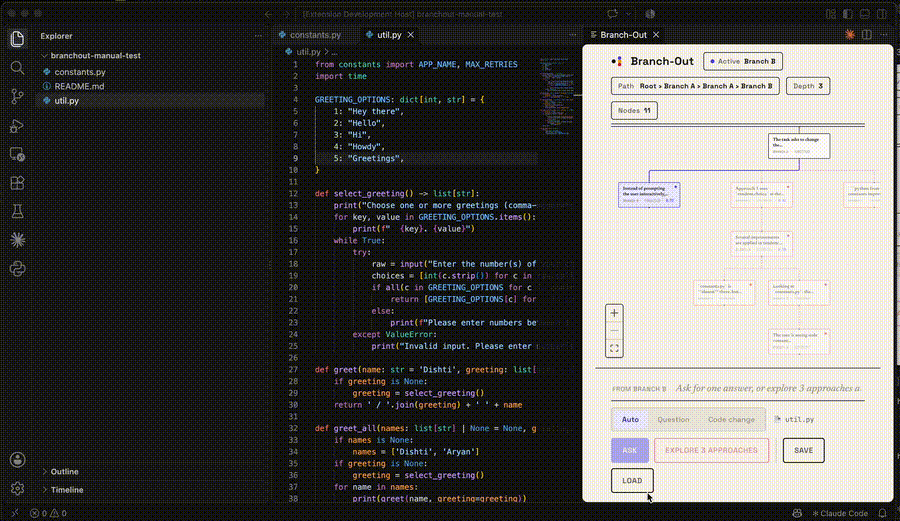
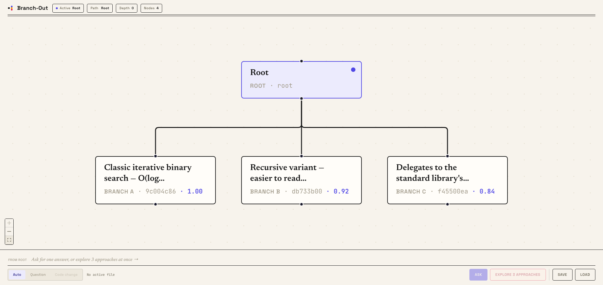
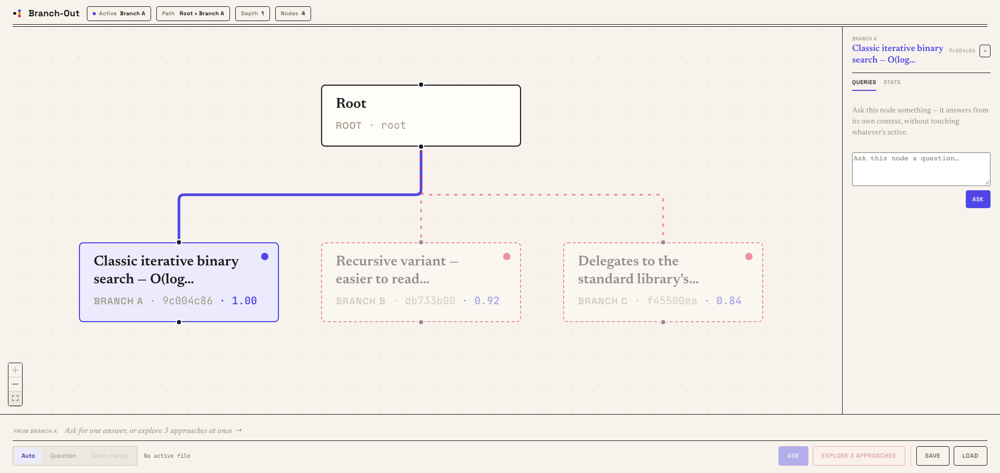
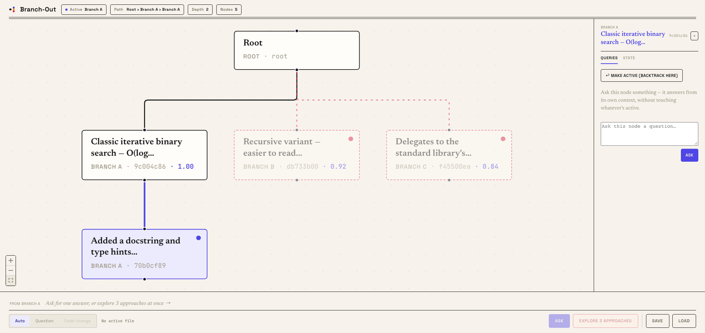
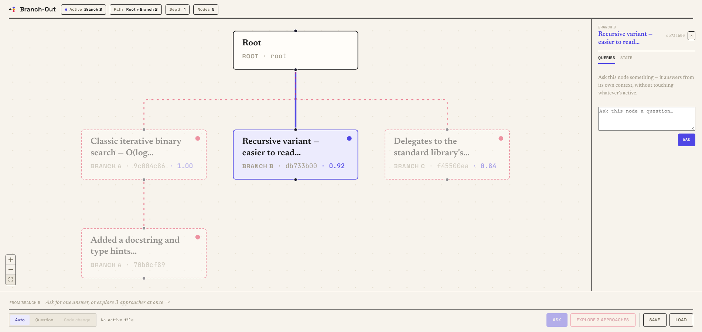
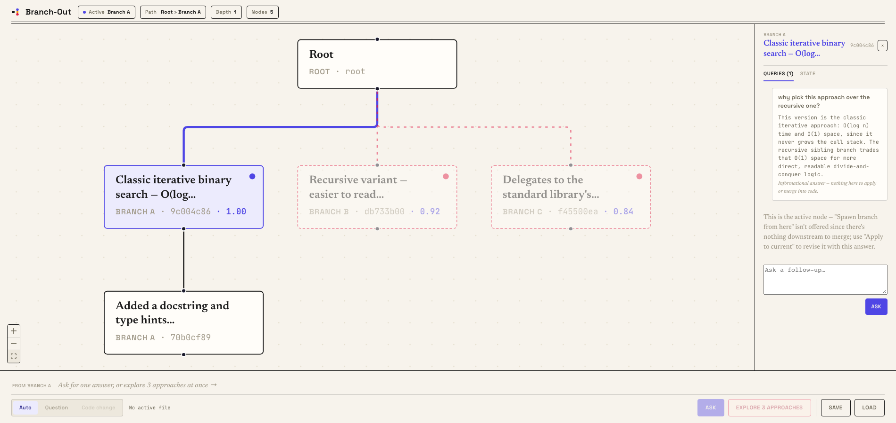
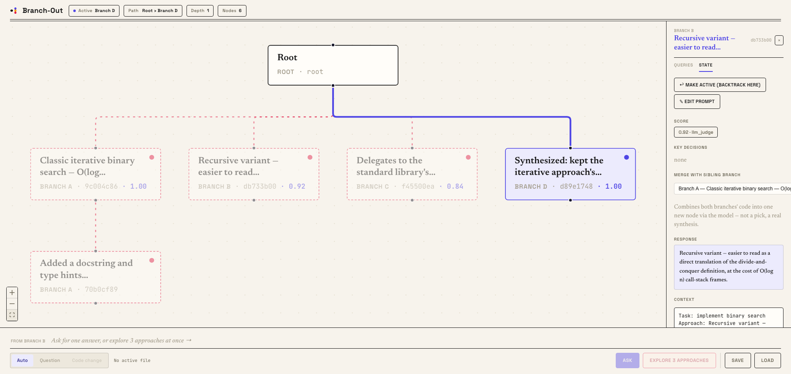
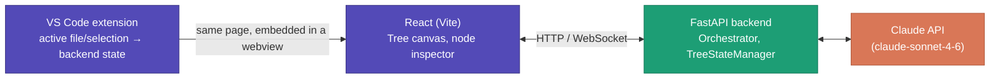

# Branch-Out

**Branch into real, codebase-grounded approaches — and never lose one.**

Branch-Out grounds every answer in your actual codebase and lets you compare real, scored approaches before committing to one, with that same context carried forward automatically on every follow-up. It does this by turning the session into a tree instead of a straight line: branch into 3 (or more) approaches in parallel, backtrack to any past decision without losing where you are now, question an old node mid-session without disturbing the active one, and merge two branches into a genuine combination of both. Every path stays exactly where you left it, dimmed but recoverable, one click from being back as it was. Available as a standalone web app and as a VS Code extension (Copilot-like, in-editor, with a visualized navigable history of every change).

**Nearly 2.5x more reliable than one call with the same codebase context, no branching — measured with real Claude API calls and real unit-test scoring across 80 coding tasks.** Full breakdown in [Benchmark](#benchmark).

Here's what that looks like inside VS Code: branch into three approaches, pick one and watch the file update, then backtrack to an earlier one and watch it revert — nothing is ever thrown away.



<sub>Recorded live in this repo's own test workspace.</sub>

---

## What it is — and isn't

A tree-structured session manager that sits between you and the Claude API. It's not a multi-agent framework (one model, one call per branch), not a git wrapper (git only runs internally, to catch file conflicts), and not speculative code execution (every branch is a complete generation, scored before anything touches disk).

Closer in spirit to inline-completion tools like Cursor or Copilot — the difference is what happens per prompt. Those give you one attempt, a single suggestion you accept or reject. Branch-Out gives you several at once: complete approaches generated in parallel, each scored before you even look at it, living as real nodes you can compare, back out of without losing your place, question individually, or combine two into one.

## The problem

Three things happen constantly in a real AI coding session, and a linear chat has no good answer to any of them:

- **Requirements change mid-task.** You're ten prompts into an approach when the real constraint surfaces ("actually, it needs to support concurrent writes"). The model's already committed to code built on the wrong assumption, and everything since has to be reconciled against it: output that starts second-guessing itself trying to honor both the old and new context, real rework across every file that assumed the wrong design, and a thread edging toward its context limit from carrying all of it.
- **You want to compare real options, not just the first thing that came back.** Asking for "approach A," not liking it, then asking for "approach B instead" doesn't give you two approaches — it gives you one conversation that's now confused about which one it's actually building, with A's half-finished reasoning still polluting B's context.
- **An earlier decision turns out to be wrong, after you've already built on top of it.** Going back means either losing everything you did since, or manually copying code out before you regenerate — recovering the earlier path means destroying the later one.

## Why a tree is the fix, not just a nicer UI

The usual workarounds are all the same idea wearing different clothes: open a second chat tab, paste the context into a fresh conversation, keep a scratch file of "the version I liked earlier." They all work, but they're manual bookkeeping you do by hand — ad hoc, hard to compare side by side, and disconnected from actually doing anything with what you noticed. If you liked branch A's error handling and branch B's data model, turning "I noticed that" into a node that actually has both means building it yourself.

A tree makes that bookkeeping structural instead of manual:
- **Changing requirements** → `clarify-and-apply`: answer the clarifying question on the node where it came up, apply it forward onto where you actually are now — real git-based conflict detection catches what a plain regenerate would silently overwrite.
- **Comparing real options** → `branch`: N approaches generated in parallel, each genuinely isolated (its own node, its own context), scored automatically so "which one's actually better" has a real signal behind it instead of a gut call.
- **A wrong earlier decision** → `backtrack`: instant, lossless — the path you leave dims but is never deleted, and jumping back to it revives it exactly as it was.
- **"I liked parts of both"** → `merge siblings`: a real synthesis of two branches into one new node, not a manual copy-paste.

## What it does

- **Branch**: ask for 3 (or N) approaches to the same prompt in parallel; each becomes its own node, scored automatically (test-based when the code has tests, LLM-judged otherwise).
- **Backtrack**: jump to any past node — the active cursor moves there, everything off that path dims (orphaned, never deleted), and anything revisited revives instantly.
- **Query**: ask a past node a question without touching the currently active node — the one thing a tree gives you that a linear chat can't.
- **Clarify-and-apply / clarify-and-branch**: answer a clarifying question on a past node, then either apply it onto the current node (with real git-based conflict detection) or spawn a fresh branch with the accumulated preferences folded in.
- **Merge sibling branches**: pick two branches from one fan-out and have the model synthesize a single combined solution — a real synthesis, not a pick.
- **File-grounded, VS Code-aware**: inside the IDE, Branch-Out knows your active file and selection live; activating a node (backtrack, continue, merge) writes straight to disk, with a conflict banner instead of a silent overwrite if the file moved on independently.
- **Auto-classifying intent**: a plain "Ask" doesn't force you to pre-declare question vs. code-change — the model classifies itself, and an explicit override always wins over its guess.

<details>
<summary><b>Screenshots</b> (click to expand — one per feature above)</summary>

**Branch** — one prompt fans out into 3 scored approaches, each its own node:


**Node inspector** — pick a branch and its code, score, and query box open on the side; the other two dim:


**Continue** — a single follow-up grows the active path by one child node, not a new fan-out:


**Backtrack** — activating a different branch swaps which subtree is dimmed; nothing is ever deleted:


**Query** — ask a past, dimmed node something without touching whatever's currently active:


**Merge siblings** — combine two branches from the same fan-out into one synthesized node:


</details>

## Architecture



In-memory tree on the backend: a networkx-based context graph plus an append-only node store; git-based merge/conflict detection (`gitpython`); SQLite session persistence (explicit save/load, not continuous).

<details>
<summary><b>What each piece actually does</b> (click to expand)</summary>

- **Backend** (`backend/`): FastAPI app, one in-memory `TreeStateManager` (append-only — a node is never mutated after creation, only `status`/`children_ids` change), `Orchestrator` serializing all tree-mutating calls behind a single `asyncio.Lock`. Branch generation is always parallel (`asyncio.gather`); evaluation always fires after branches are already visible, never blocking on it.
- **Frontend** (`frontend/`): React + React Flow for the tree canvas, a node inspector (Queries/State tabs), a WebSocket for live `branch.ready`/`score.ready`/`active_editor.changed` events.
- **VS Code extension** (`vscode-extension/`): embeds the same frontend build in a webview, plus a quick-pick command for a fast, inline ask-or-branch flow without opening the full panel. Reports the real active editor/selection into the backend's shared session state, so the embedded webview and a standalone browser tab both see the same "currently targeting" file.
- **Benchmark** (`benchmark/`): a runner comparing two linear baselines (generic prompt, and the same context/prompt-engineering Branch-Out itself gets, single call) against the full branch-and-pick flow, scored against each task's own test suite.

</details>

## Benchmark

Every number below is **measured** against the real Claude API, scored against each task's own `test_suite` — never a single flat percentage, always per mode and per category. See `ROADMAP.md`'s Phase 6.1 for the task set and methodology.

| Mode | standard pass@1 (n=50) | custom pass@1 (n=30) |
|---|---|---|
| baseline-generic (raw prompt) | 0.94 | 0.967 |
| baseline-matched (same context, single call) | 0.38 | 0.767 |
| **Branch-Out** (branch + auto-pick best of 3) | **0.94** | **0.9** |

The interesting finding isn't that Branch-Out wins outright on `standard` — auto-picking the best of 3 branches exactly matches `baseline-generic`'s ceiling (0.94) and clears `baseline-matched` by nearly 2.5x. The gap *between* the two baselines is itself real and reproducible: forcing code through a compact, single-line JSON-escaped response measurably degrades this model's correctness even on trivial tasks (confirmed via a captured response whose collapsed indentation caused a plain `IndentationError`) — exactly the single-attempt fragility branching exists to recover from. On `custom` (the harder, hand-written tasks), Branch-Out lands between the two baselines rather than matching the generic ceiling — a real, reported result, not smoothed over.

## Install & run

Requires Python ≥3.10, Node ≥18, and an `ANTHROPIC_API_KEY`.

```bash
# Backend
cd backend
python3 -m venv ../.venv && source ../.venv/bin/activate
pip install -r ../requirements.txt
echo "ANTHROPIC_API_KEY=your_key_here" > .env
uvicorn main:app --port 8000 --reload

# Frontend (separate terminal)
cd frontend
npm install
npm run dev   # open http://localhost:5173
```

### VS Code extension

```bash
cd vscode-extension
npm install
npm run compile
```

Then launch an Extension Development Host:

```bash
"/Applications/Visual Studio Code.app/Contents/Resources/app/bin/code" \
  --extensionDevelopmentPath=/absolute/path/to/vscode-extension \
  /path/to/a/workspace/to/test/in
```

(F5-based debugging has been unreliable in this project's own testing — the command above is the one path that's consistently worked.) Inside that window, run **Branch-Out: Open Tree Panel** from the Command Palette, or select some code and run **Branch-Out: Ask about selection** for the fast inline quick-pick flow.

### Tests

```bash
# Backend + benchmark (no API key needed — everything mocks the LLM client)
python3 -m pytest

# Frontend typecheck/build
cd frontend && npm run build

# E2E (real browser, real server, zero API cost — see backend/tests/e2e_server.py)
cd frontend && npm run e2e

# Benchmark against the real API (costs real money — see benchmark/runner.py)
cd backend && python3 ../benchmark/runner.py --baseline-generic --baseline-matched --branchout
```

## Project discipline

This is a solo portfolio project. `ROADMAP.md` tracks what was implemented, phase by phase. `CLAUDE.md` holds the non-negotiable constraints (append-only tree, async branch generation, fail-open discipline, etc.) that every change is checked against.
